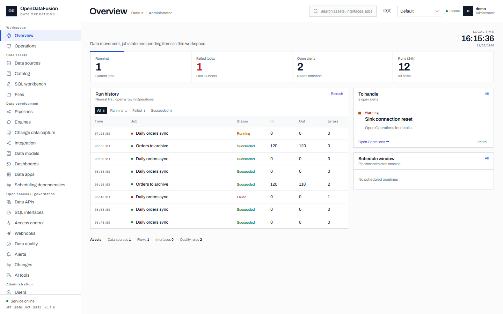
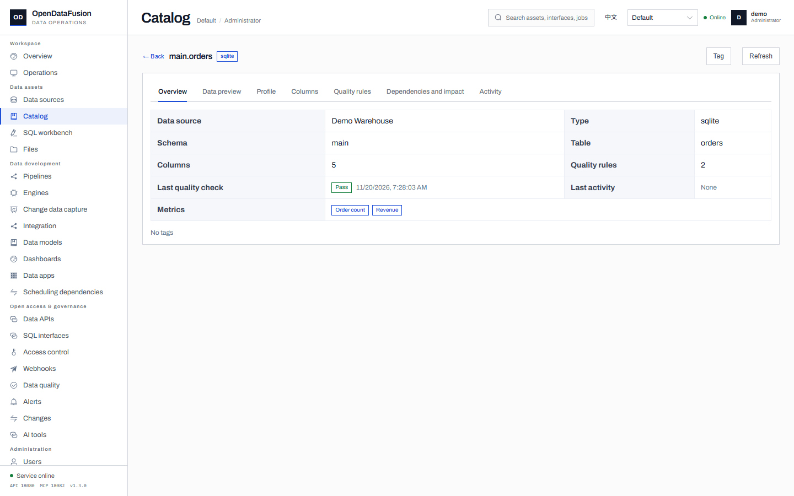
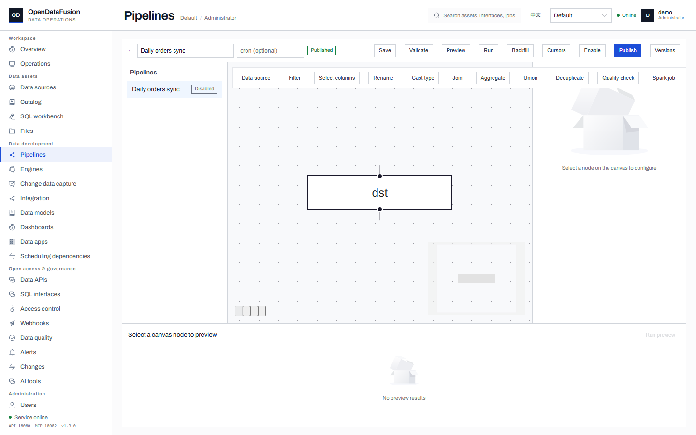
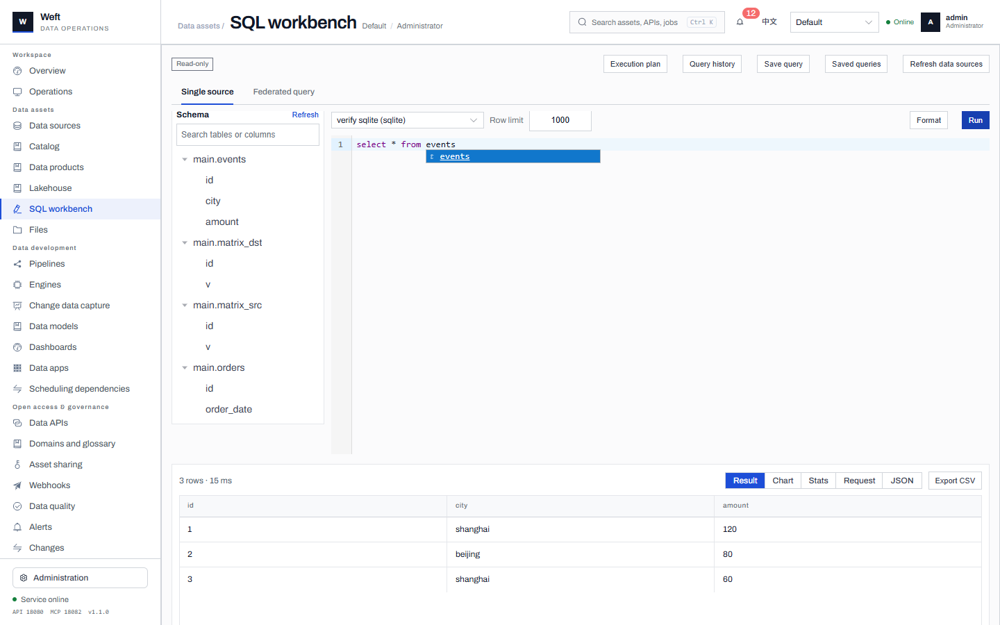
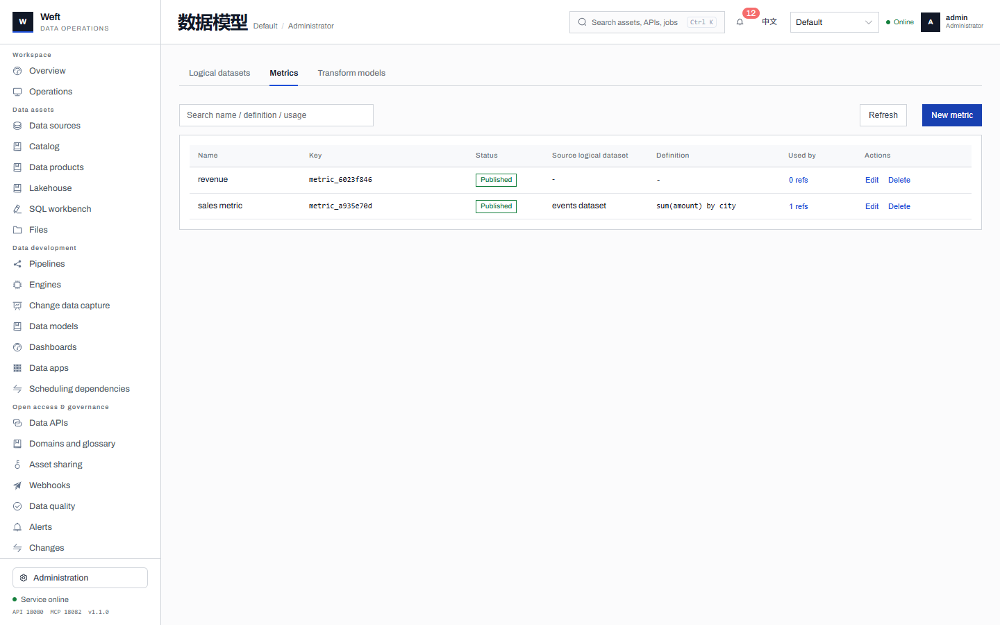
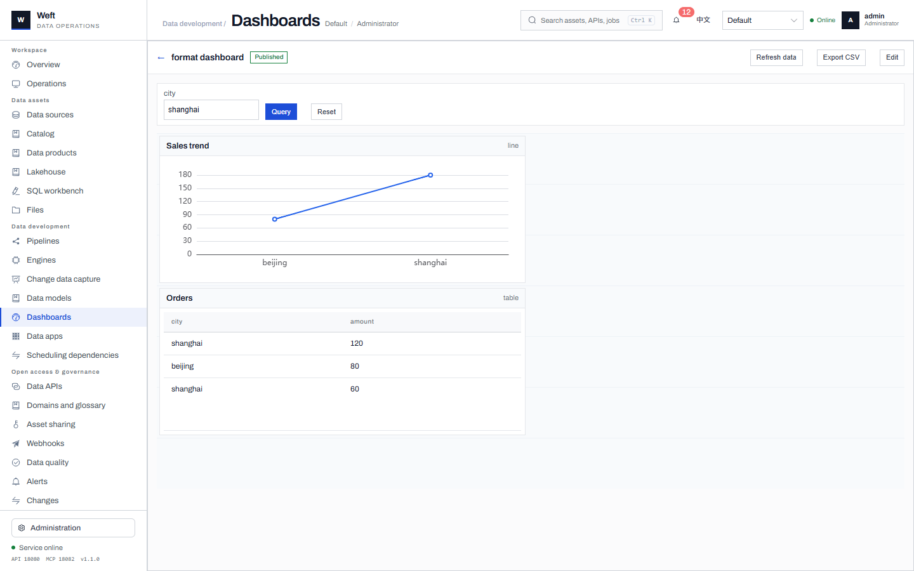
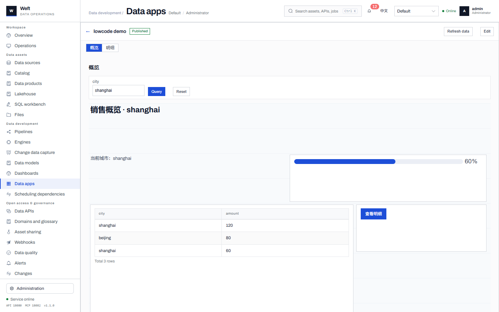
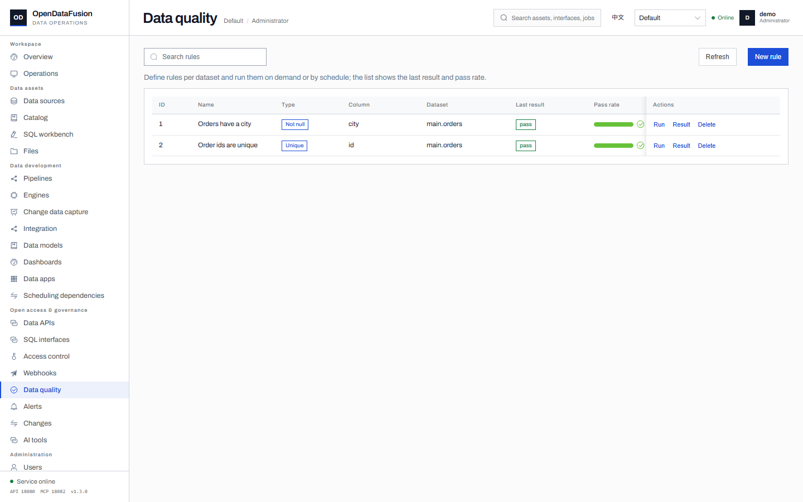
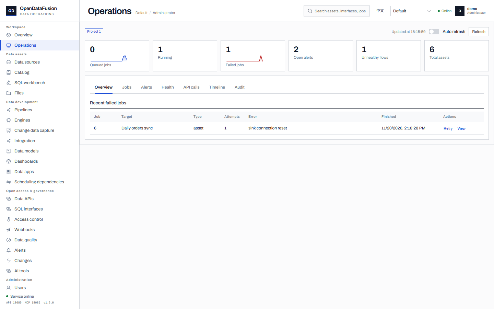

# Weft Data Platform

**An API-first, open-source low-code data platform for the full data delivery loop.**

Connect sources, move and transform data, model datasets and metrics, publish
governed APIs, build dashboards and internal apps, and operate the estate from
one project-scoped console. External operators can use the same capabilities
over MCP.

[English](README.md) · [简体中文](README.zh-CN.md)

[](https://github.com/CildCo/weft/actions/workflows/ci.yml)
[](LICENSE)
[](https://github.com/CildCo/weft/releases)
[](https://github.com/CildCo/weft/pkgs/container/weft)



*A short tour: overview, catalog profiling, pipeline studio, metrics and dashboards.*


<details>
<summary>Contents</summary>

- [What's new in 1.1.0](#whats-new-in-110)
- [What is Weft?](#what-is-weft)
- [Explore the console](#explore-the-console)
- [Why Weft](#why-weft)
- [Feature overview](#feature-overview)
- [Integration-tested paths](#integration-tested-paths)
- [Architecture](#architecture)
- [Quick start](#quick-start)
- [Documentation](#documentation)
- [Development](#development)
- [Community](#community)
- [Security](#security)
- [License](#license)

</details>

## What's new in 1.1.0

Version 1.1.0 is the new baseline for the public project. It packages the
complete current platform into one release:

- **Data products** as first-class assets with owners, SLAs, terms and member
  assets, plus product packaging and bundle export.
- **Data standards** management and column-level standard mapping in the
  catalog, with governed write routes and audit entries.
- **External metadata import** for dbt manifests and BI metadata, with
  read-only external datasets in the physical catalog.
- **Low-code app widgets**: file upload, approval queues, reusable lists and
  built-in application templates.
- **Asset trust and lifecycle**: certification, lifecycle notes, run priority,
  duration SLAs and health views.
- **Cost attribution and distribution drift** in operations and quality.
- **Embed SDK, page roles, conditional styles and bulk glossary import** for
  production-ready sharing and governance.
- **DuckDB quality rules and pipeline node editing fixes**, verified against a
  live integration environment.
- **Product renamed to Weft Data Platform (short: Weft)**, with the stable
  `odf` technical namespace retained for existing deployments.

The project now counts from 1.1.0. Earlier public releases and tags were
retired during this reset; the git history remains intact.

## What is Weft?

Weft is an open-source, self-hosted data platform that combines the
jobs usually split across ingestion tools, transformation frameworks, catalogs,
BI tools and internal-tool builders in one project-scoped workspace. It ships a
visual pipeline studio, a governed API studio, dataset/metric modelling,
dashboards, data apps, a lakehouse layer over Apache Iceberg with Trino, Spark
and Flink execution, Debezium change data capture, and an MCP server so external
operators can use the same capabilities.

**Use it when you need:** a low-code ETL/ELT and data integration platform; a
data catalog with lineage and quality rules; governed data APIs with AK/SK;
self-service dashboards and internal apps; or a lakehouse control plane on
Kubernetes.

<details>
<summary>Search keywords</summary>

open-source data platform, low-code ETL, ELT, data integration, data pipeline,
lakehouse, Apache Iceberg, Nessie, Trino, Apache Spark, Apache Flink, Kafka,
Debezium, CDC, data catalog, data lineage, data quality, data governance, API
gateway, internal tools, BI dashboards, data products, semantic layer, MCP, AI
data agents, FastAPI, Vue 3, Kubernetes.

</details>

## Explore the console

The screenshots below are the English console; every page is also available in
Chinese from the header switch.

| | |
| --- | --- |
|  **Catalog and profiling.** Table and column search, tags, a masked sample, profiling, quality rules, impact analysis and activity in one detail page. |  **Pipeline Studio.** Visual DAGs with source, filter, join, aggregate, quality, engine and sink nodes; schema validation, preview, versioned publish, scheduling and bounded backfill. |
|  **SQL workbench.** Read-only queries with governed sources, schema completion, result charts, execution plans and CSV export. |  **Semantic layer.** A metric catalogue with source dataset, definition, owner and the dashboards and apps that consume it. |
|  **Dashboards.** Cards, charts, tables, maps and text on a 12-column grid, with filters, drill-through, scheduled reports, versioned publish and expiring share links. |  **Data apps.** Multi-page internal apps with parameters, metric cards, tables, uploads, approval queues and audited forms over published datasets. |
|  **Data quality.** Freshness, null, uniqueness, range, enum, drift and schema rules with pass rates, SLA alerts and per-run results. |  **Operations.** Queue and failures, dead-letter replay, alert triage, dependency skips, cost attribution, API calls and audit in one console. |

## Why Weft

- **One delivery loop.** Source → pipeline → dataset/metric → API, dashboard,
  app or data product, with lineage, quality, approvals and audit in the same
  product model.
- **Operable by design.** A durable PostgreSQL job queue, retrying workers, a
  single scheduler leader, cursor-safe backfill, health events, metrics and
  backup scripts.
- **Governance is visible.** Column masking, row policies, governed SQL
  restrictions, data standards, quality rules and approval-gated publishing are
  first-class states, not hidden error paths.
- **Runs on your data plane.** Execution adapters cover relational databases,
  DuckDB, object storage, Trino/Iceberg, Spark and Flink without changing the
  asset catalogue or permission model.
- **AI-operable without a chat UI.** An MCP server exposes read tools and
  approval-gated write tools to external agents. Every management action is
  also available over HTTP.

## Feature overview

| Area | What you get |
| --- | --- |
| **Data sources** | A connector registry covering relational databases, openGauss, KingbaseES, GaussDB, Dameng DM, ClickHouse, Trino, DuckDB, Hive/Spark Thrift, S3/MinIO, files, HTTP, Elasticsearch, MongoDB, Kafka and Airbyte-protocol sources. Typed forms, capability scopes, pre-save tests, encrypted DSNs, metadata sync and schema-drift alerts. |
| **Pipeline Studio** | Visual DAGs with source, filter, select, rename, cast, join, aggregate, union, dedupe, quality, Spark, Flink SQL and sink nodes; schema validation; per-node error policy; preview; versioned publish; cron; cursor inspection/reset; bounded backfill; templates and failure handling. |
| **API Studio** | Visual single-table queries or guarded SQL; typed parameters; preview/test; approval-gated publish and rollback; generated docs; AK/SK-signed execution at `/openapi/{key}`; a GraphQL gateway with schema introspection at `/openapi/graphql`. |
| **Model Studio** | Dataset, metric and transform-model assets; visual and SQL datasets; expression metrics; time grains and comparison; SQL models with refs, view/table/incremental materialisations, tests, warehouse layers and column lineage; approval publishing. |
| **Dashboard Studio** | 12-column dashboards with cards, charts, tables, maps and text; filters and parameter binding; drill-through; GeoJSON maps; scheduled CSV reports; drag/resize editor; versioned publish; read-only runtime, share links and embed snippets. |
| **App Studio** | Multi-page apps with parameters, bindings, actions, page roles, component styles, conditional highlights, containers, tabs, modals, uploads, approval queues and lists; app templates; public share mode that strips write components. |
| **Data products** | Product assets with owner, SLA, terms and member assets; packaging and bundle export; cost attribution by project; usage and lineage in one view. |
| **Lakehouse** | Trino data sources over Apache Iceberg with table health, snapshots, exact snapshot time travel, file optimisation, snapshot expiry and scheduled maintenance. |
| **Compute engines** | Spark applications through the Spark Operator and Flink SQL through the SQL Gateway: submit, inspect, cancel and savepoint, with a lakehouse profile applied by default. |
| **Change data capture** | Debezium connectors for PostgreSQL, MySQL and Oracle created, paused, resumed and monitored from the platform; changes land in Kafka for Flink or Spark; generated CDC pipelines support schema evolution and deletes. |
| **Catalog and lineage** | Table and column search, tags, domains and glossary, column-level lineage, downstream impact analysis, OpenLineage events, external metadata import and a JSON catalog export. |
| **Governance** | Column classification and masking, row policies, data standards and column mapping, contracts with freshness/quality checks, quality SLA alerts, approval-gated changes and audit-backed policy updates. |
| **Operations** | Ops centre, queue summary, retries, dead-letter replay, dependency-aware scheduling, alert assignment and notes, cost attribution, retention and archive, Prometheus metrics and backup/restore. |
| **Administration** | Platform console for users and roles, projects and quotas, sign-in policy, OIDC/LDAP, branding and announcements, feature flags, engine, CDC, Airbyte and lineage settings, backups and platform audit. |
| **Open API and MCP** | Management API, signed public gateway, streamable HTTP MCP server, stdio MCP entry point and approval-token-protected write tools. |

## Integration-tested paths

The current release was exercised end to end through the console against a live
data plane, including:

- Trino/Iceberg datasource query, catalog detail, lakehouse health, snapshots,
  time travel and a materialised model table.
- Flink SQL statements through the SQL Gateway and Spark execution profiles.
- DuckDB and openGauss connectors with datasource tests, metadata sync and
  governed queries.
- Airbyte-protocol connectors through the administrator command allowlist.
- A Kafka source-to-sink pipeline with messages confirmed in the sink topic.
- DuckDB dataset → metric → dashboard map rendering, contract generation with
  scheduled check history, and a quality SLA breach raising an alert.
- Role isolation, retention, datasource limits, dead-letter replay, GraphQL,
  exports, embeds and mobile navigation.

## Architecture

```text
                 ┌──────────────────────────────┐
                 │  reverse proxy / TLS         │
                 └──────────────┬───────────────┘
                                │
        ┌───────────────────────┼───────────────────────┐
        ▼                       ▼                       ▼
┌───────────────┐      ┌─────────────────┐     ┌─────────────────┐
│ odf-api       │      │ odf-mcp         │     │ static console  │
│ FastAPI       │      │ streamable HTTP │     │ Vue 3 / /ui/    │
└───────┬───────┘      └────────┬────────┘     └─────────────────┘
        │                       │
        └───────────┬───────────┘
                    ▼
          ┌──────────────────┐
          │ PostgreSQL       │
          │ control + jobs   │
          └───────┬──────────┘
                  │
        ┌─────────┴─────────┐
        ▼                   ▼
┌───────────────┐    ┌─────────────────┐
│ odf-scheduler │    │ odf-worker × N  │
│ leader lock   │    │ SKIP LOCKED     │
└───────────────┘    └─────────────────┘
```

The API is stateless. Scheduling and execution are durable and scale separately.
See [Architecture](docs/ARCHITECTURE.md), [Delivery](docs/DELIVERY.md),
[HA](docs/HA.md) and [Security](docs/SECURITY.md).

## Quick start

### Docker Compose

```bash
git clone https://github.com/CildCo/weft.git
cd weft/deploy/docker
cp .env.example .env
./../../scripts/generate-env.sh .env
docker compose up -d --build
docker compose exec api weft create-admin \
  --username admin --password 'ChangeMe123!'
```

Open <http://localhost:18080/ui/> and sign in. The API listens on `18080`;
MCP listens on `18082`.

### Local development

```bash
cd impl
python -m venv .venv
.venv/bin/pip install -e ".[dev]"
cp .env.example .env
# set ODF_DATABASE_URL, ODF_JWT_SECRET and ODF_FERNET_KEY
.venv/bin/alembic upgrade head
.venv/bin/weft create-admin \
  --username admin --password 'ChangeMe123!'

# separate terminals
.venv/bin/uvicorn odf.main:app --host 127.0.0.1 --port 18080
.venv/bin/python -m odf.scheduler
.venv/bin/python -m odf.worker
```

The frontend is built into `impl/odf/static` and served at `/ui/`. For frontend
development, see [frontend/README.md](frontend/README.md).

## Documentation

| Document | Contents |
| --- | --- |
| [Architecture](docs/ARCHITECTURE.md) | Processes, execution semantics, scaling and failure model |
| [Delivery](docs/DELIVERY.md) | Docker, Compose, Helm and systemd |
| [Governance](docs/GOVERNANCE.md) | Catalog, lineage, masking, row policies, standards, contracts, quality and audit |
| [HA](docs/HA.md) | Leader election, worker scaling, backup and restore |
| [Security](docs/SECURITY.md) | Trust boundaries, secrets, SSRF controls and reporting |
| [Performance](docs/PERFORMANCE.md) | Metrics, pools, load tests and benchmark results |
| [Benchmarks](docs/BENCHMARKS.md) | 30GB multi-source results and cache experiments |
| [Testing](docs/TESTING.md) | Unit, integration, browser and full-matrix tests |
| [Environments](docs/ENVIRONMENTS.md) | Environment labels, asset bundles and promotion |
| [Connector SDK](docs/CONNECTOR_SDK.md) | Register an external connector package |
| [Airbyte](docs/AIRBYTE.md) | Run Airbyte-protocol sources as pipeline inputs |
| [Transform models](docs/MODELS.md) | SQL models, refs, materializations, tests and layers |
| [Lakehouse](docs/LAKEHOUSE.md) | Snapshots, time travel, health and maintenance schedules |
| [Lineage and catalog export](docs/LINEAGE.md) | OpenLineage events and external catalog sync |
| [Query workbench and performance](docs/QUERY.md) | Query history, execution plans and P50/P95 analysis |
| [Change data capture](docs/STREAMING.md) | Debezium sources and generated CDC pipelines |
| [Templates](docs/TEMPLATES.md) | Model and pipeline starting points |
| [Operations](docs/OPERATIONS.md) | Retention, dead letters, datasource limits, system check and HA smoke tests |
| [Editing experience](docs/INTERACTION.md) | Undo/redo, canvas copy and layout, gallery, backfill preview and run matrix |
| [User guide](docs/USER_GUIDE.md) | Every console page and action (also in [Chinese](docs/USER_GUIDE.zh-CN.md)) |

## Development

- Backend: Python 3.11, FastAPI, SQLAlchemy 2, Alembic, PostgreSQL.
- Frontend: Vue 3, Vite, Element Plus, Vue Flow, CodeMirror, ECharts.
- The `odf` Python package, `ODF_*` environment variables and systemd unit
  names are the stable technical namespace retained for existing deployments;
  the product and console use the Weft brand.
- Default branch: `main`. Pull requests run unit, integration, browser and Helm checks.
- Read [CONTRIBUTING.md](CONTRIBUTING.md) before opening a pull request.
- Console tests: `cd frontend && npm ci && npx playwright install chromium && npm run test:e2e`.

## Community

- [GitHub Issues](https://github.com/CildCo/weft/issues) — bugs and
  concrete feature requests.
- [GitHub Discussions](https://github.com/CildCo/weft/discussions) —
  design questions, deployment help and show-and-tell.
- [Roadmap](ROADMAP.md) and [Changelog](CHANGELOG.md).
- [Code of Conduct](CODE_OF_CONDUCT.md) and [Support](SUPPORT.md).

## Security

Report suspected vulnerabilities privately as described in
[SECURITY.md](SECURITY.md); please do not open a public issue. The platform
keeps secrets encrypted at rest, validates outbound webhook hosts, runs the SQL
workbench read-only and gates publishing behind approval and audit.

## License

Apache License 2.0. See [LICENSE](LICENSE). The project name and marks are
covered by [TRADEMARK.md](TRADEMARK.md); forks are welcome, but please do not
imply endorsement.
