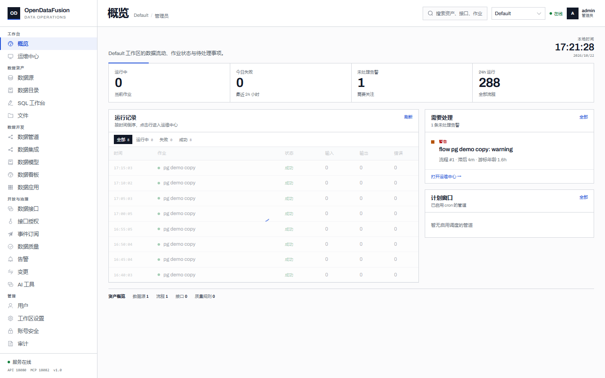

# OpenDataFusion

**An API-first, open-source low-code data platform for the full data delivery loop.**

Connect sources, move and transform data, model datasets and metrics, publish governed APIs, build dashboards and internal apps, and operate the estate from one project-scoped console. External operators can use the same capabilities over MCP.

[English](README.md) · [简体中文](README.zh-CN.md)

[](https://github.com/CildCo/opendatafusion/actions/workflows/ci.yml)
[](LICENSE)
[](https://github.com/CildCo/opendatafusion/releases)
[](https://github.com/CildCo/opendatafusion/pkgs/container/opendatafusion)



## Why OpenDataFusion

- **One delivery loop.** Source → pipeline → dataset/metric → API, dashboard or app, with lineage, quality, approvals and audit in the same product model.
- **Operable by design.** A durable PostgreSQL job queue, retrying workers, a single scheduler leader, cursor-safe backfill, health events, metrics and backup scripts.
- **Governance is visible.** Column masking, row policies, governed SQL restrictions, quality rules and approval-gated publishing are first-class states, not hidden error paths.
- **AI-operable without a chat UI.** An MCP server exposes read tools and approval-gated write tools to external agents. Every management action is also available over HTTP.

## Feature overview

| Area | What you get |
| --- | --- |
| **Data sources** | PostgreSQL, MySQL/MariaDB, SQLite, Oracle, SQL Server, ClickHouse, HTTP, Elasticsearch and CSV/TSV/Parquet/JSON/Excel files. Encrypted DSNs, connectivity tests, metadata sync and schema-drift alerts. |
| **Pipeline Studio** | Visual DAGs with source, filter, select, rename, cast, join, aggregate, union, dedupe, quality and sink nodes; schema validation; per-node error policy; preview; versioned publish; cron; cursor inspection/reset; bounded backfill. |
| **API Studio** | Visual single-table queries or guarded SQL; typed parameters; preview/test; approval-gated publish and rollback; generated docs; AK/SK-signed execution at `/openapi/{key}`. |
| **Model Studio** | Dataset and metric assets over curated tables; schema; preview; approval publishing; AI read tools. |
| **Dashboard Studio** | 12-column dashboard assets with cards, charts, tables and text; filters and parameter binding; drag/resize editor; versioned publish; read-only runtime and expiring share links. |
| **App Studio** | Multi-page internal apps with parameters, metric cards, tables, row-detail drawers and audited insert/update/delete forms over published datasets. |
| **Catalog & lineage** | Table and column search, tags, column-level lineage, downstream impact analysis and health events. |
| **Governance** | Column classification and masking, row policies, data standards, freshness/regex/enum/schema quality rules and audit-backed policy changes. |
| **Operations** | Ops center, queue summary, job retry, alert acknowledgement, Prometheus metrics, request IDs, JSON logs, backup/restore and HA guidance. |
| **Open API & MCP** | Management API, signed public gateway, streamable HTTP MCP server, stdio MCP entry point and approval-token-protected write tools. |

## Architecture

```text
                 ┌──────────────────────────────┐
                 │  reverse proxy / TLS         │
                 └──────────────┬───────────────┘
                                │
        ┌───────────────────────┼───────────────────────┐
        ▼                       ▼                       ▼
┌───────────────┐      ┌─────────────────┐     ┌─────────────────┐
│ odf-api       │      │ odf-mcp         │     │ static console  │
│ FastAPI       │      │ streamable HTTP │     │ Vue 3 / /ui/    │
└───────┬───────┘      └────────┬────────┘     └─────────────────┘
        │                       │
        └───────────┬───────────┘
                    ▼
          ┌──────────────────┐
          │ PostgreSQL       │
          │ control + jobs   │
          └───────┬──────────┘
                  │
        ┌─────────┴─────────┐
        ▼                   ▼
┌───────────────┐    ┌─────────────────┐
│ odf-scheduler │    │ odf-worker × N  │
│ leader lock   │    │ SKIP LOCKED     │
└───────────────┘    └─────────────────┘
```

The API is stateless. Scheduling and execution are durable and scale separately. See [Architecture](docs/ARCHITECTURE.md), [Delivery](docs/DELIVERY.md), [HA](docs/HA.md) and [Security](docs/SECURITY.md).

## Quick start

### Docker Compose

```bash
git clone https://github.com/CildCo/opendatafusion.git
cd opendatafusion/deploy/docker
cp .env.example .env
./../../scripts/generate-env.sh .env
docker compose up -d --build
docker compose exec api python -m odf.cli create-admin \
  --username admin --password 'ChangeMe123!'
```

Open <http://localhost:18080/ui/> and sign in. The API listens on `18080`;
MCP listens on `18082`.

### Local development

```bash
cd impl
python -m venv .venv
.venv/bin/pip install -e ".[dev]"
cp .env.example .env
# set ODF_DATABASE_URL, ODF_JWT_SECRET and ODF_FERNET_KEY
.venv/bin/alembic upgrade head
.venv/bin/python -m odf.cli create-admin \
  --username admin --password 'ChangeMe123!'

# separate terminals
.venv/bin/uvicorn odf.main:app --host 127.0.0.1 --port 18080
.venv/bin/python -m odf.scheduler
.venv/bin/python -m odf.worker
```

The frontend is built into `impl/odf/static` and served at `/ui/`. For frontend
development, see [frontend/README.md](frontend/README.md).

## Documentation

| Document | Contents |
| --- | --- |
| [Architecture](docs/ARCHITECTURE.md) | Processes, execution semantics, scaling and failure model |
| [Delivery](docs/DELIVERY.md) | Docker, Compose, Helm and systemd |
| [Governance](docs/GOVERNANCE.md) | Catalog, lineage, masking, row policies, quality and audit |
| [HA](docs/HA.md) | Leader election, worker scaling, backup and restore |
| [Security](docs/SECURITY.md) | Trust boundaries, secrets, SSRF controls and reporting |
| [Performance](docs/PERFORMANCE.md) | Metrics, pools, load tests and benchmark results |
| [Benchmarks](docs/BENCHMARKS.md) | 30GB multi-source results and cache experiments |
| [Testing](docs/TESTING.md) | Unit, integration, browser and full-matrix tests |

## Development

- Backend: Python 3.11, FastAPI, SQLAlchemy 2, Alembic, PostgreSQL.
- Frontend: Vue 3, Vite, Element Plus, Vue Flow, CodeMirror, ECharts.
- Default branch: `main`. Pull requests run unit, integration, browser and Helm checks.
- Read [CONTRIBUTING.md](CONTRIBUTING.md) before opening a pull request.
- Security reports: follow [SECURITY.md](SECURITY.md); do not open a public issue
  for a suspected vulnerability.

## Community

- [GitHub Issues](https://github.com/CildCo/opendatafusion/issues) — bugs and
  concrete feature requests.
- [GitHub Discussions](https://github.com/CildCo/opendatafusion/discussions) —
  design questions, deployment help and show-and-tell.
- [Roadmap](ROADMAP.md) and [Changelog](CHANGELOG.md).
- [Code of Conduct](CODE_OF_CONDUCT.md).

## License

Apache License 2.0. See [LICENSE](LICENSE). The project name and marks are
covered by [TRADEMARK.md](TRADEMARK.md); forks are welcome, but please do not
imply endorsement.
