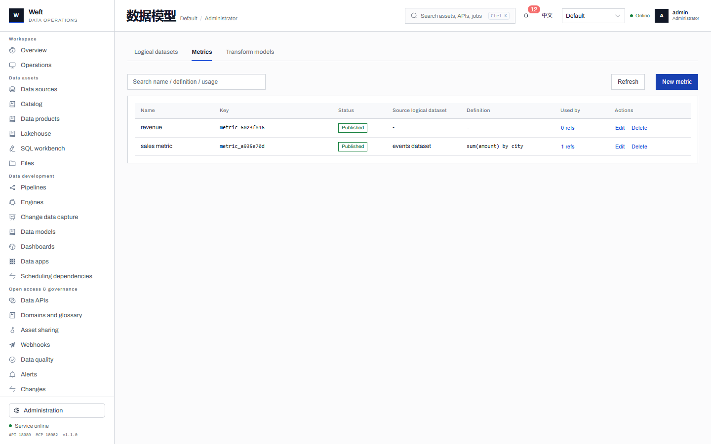
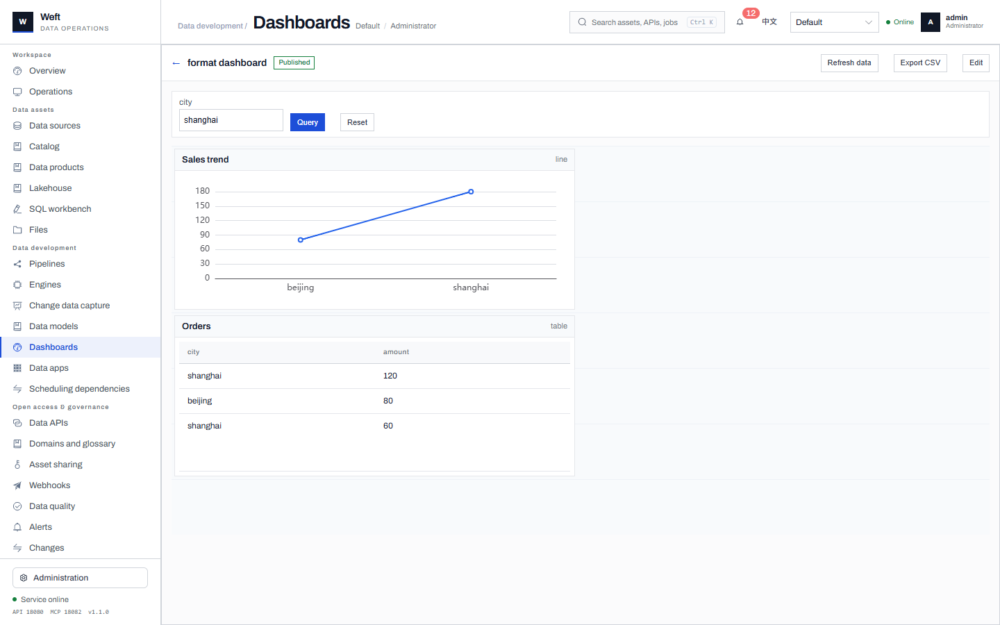
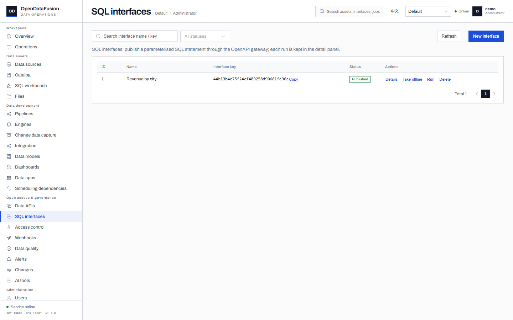
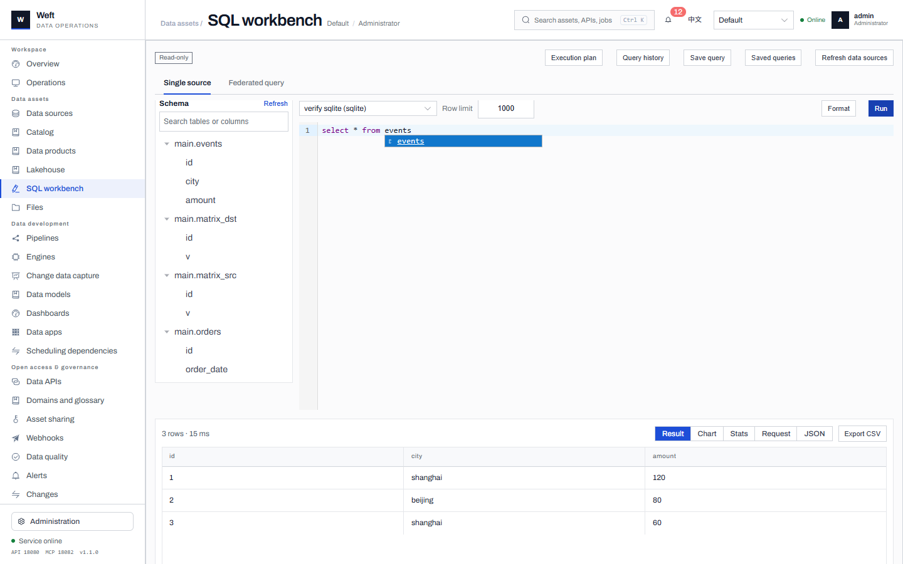

# OpenDataFusion

**API 优先的开源低代码数据平台，覆盖数据交付的完整闭环。**

连接数据源，完成数据同步与加工，构建数据集和指标，发布受治理的数据接口，
搭建看板与内部应用，并在同一个项目空间中完成运维。外部 AI 操作方可以通过
MCP 使用同一套能力。

[English](README.md) · [简体中文](README.zh-CN.md)

[](https://github.com/CildCo/opendatafusion/actions/workflows/ci.yml)
[](LICENSE)
[](https://github.com/CildCo/opendatafusion/releases)
[](https://github.com/CildCo/opendatafusion/pkgs/container/opendatafusion)


*简短演示：概览、数据目录探查、管道 Studio、指标与看板。*


<details>
<summary>目录</summary>

- [OpenDataFusion 是什么？](#opendatafusion-是什么)
- [界面一览](#界面一览)
- [为什么选择 OpenDataFusion](#为什么选择-opendatafusion)
- [功能概览](#功能概览)
- [架构](#架构)
- [快速开始](#快速开始)
- [文档](#文档)
- [开发](#开发)
- [社区](#社区)
- [安全](#安全)
- [许可证](#许可证)

</details>

## OpenDataFusion 是什么？

OpenDataFusion 是一个开源自托管的数据平台，把通常分散在数据集成、转换、目录、BI 和内部工具里的工作合并到同一个按项目隔离的工作区：可视化数据管道、受治理的数据接口、数据集/指标建模、数据看板、数据应用，以及基于 Apache Iceberg 的湖仓层（Trino、Spark、Flink 执行）、Debezium 增量同步，并提供 MCP 服务让外部操作方调用同一套能力。

**适用场景：** 低代码 ETL/ELT 与数据集成平台；带血缘和质量规则的数据目录；带 AK/SK 鉴权的数据开放接口；自助式看板与内部应用；Kubernetes 上的湖仓控制面。

<details>
<summary>搜索关键词</summary>

开源数据平台、低代码 ETL、数据集成、数据管道、湖仓、Apache Iceberg、Nessie、Trino、Apache Spark、Apache Flink、Kafka、Debezium、CDC、数据目录、数据血缘、数据质量、数据治理、API 网关、内部工具、BI 看板、MCP、大模型数据代理、FastAPI、Vue 3、Kubernetes。

</details>

## 界面一览

以下截图为英文界面；每个页面都可以通过页头切换到中文。

| | |
| --- | --- |
|  **数据目录与探查。** 表与字段搜索、标签、脱敏样例、数据探查、质量规则、影响分析与操作历史集中在一个详情页。 |  **管道 Studio。** 可视化 DAG，覆盖 source、filter、join、aggregate、quality、sink 等节点；schema 校验、预览、版本化发布与有界回填。 |
|  **管道 Studio。** 可视化 DAG，支持转换、计算引擎节点、游标、版本化发布、调度与依赖。 |  **指标语义层。** 指标目录展示来源数据集、定义、负责人，以及使用它的看板和应用的引用关系。 |
|  **数据看板。** 12 列栅格上的卡片、图表、表格和文本，支持筛选、版本化发布和限时分享链接。 |  **数据应用。** 多页内部应用，支持参数、指标卡、表格，以及基于已发布数据集的带审计写表单。 |
|  **数据质量。** freshness、空值、唯一性、范围、枚举和 schema 规则，展示通过率与每次运行结果。 |  **运维中心。** 队列与失败、告警处理、流程健康、依赖跳过、接口调用和审计集中在一个控制台。 |
|  **受治理的数据 API。** 可视化或 SQL API 支持类型化参数、发布、调用记录、授权与 AK/SK 签名网关访问。 |  **SQL 工作台。** 只读查询、受控数据源、跨源查询与 CSV 导出。 |

## 为什么选择 OpenDataFusion

- **一条完整交付链路**：数据源 → 管道 → 数据集/指标 → 接口、看板或应用；
  血缘、质量、审批和审计都在同一套产品模型里。
- **为运维而设计**：PostgreSQL 持久化任务队列、可重试 worker、单 leader
  调度器、游标安全回填、健康事件、指标和备份脚本。
- **治理状态可见**：列脱敏、行策略、受限数据源、质量规则和审批发布都是
  明确的产品状态，而不是藏在错误路径里的行为。
- **无需内置聊天框即可被 AI 操作**：MCP 服务向外部智能体提供只读工具和
  受审批保护的写工具；所有管理动作同时也通过 HTTP API 提供。

## 功能概览

| 领域 | 能力 |
| --- | --- |
| **数据源** | 通过统一注册表接入 25 种数据源：PostgreSQL、MySQL/MariaDB、SQLite、Oracle、SQL Server、TiDB、Apache Doris、StarRocks、OceanBase、openGauss、KingbaseES、GaussDB、达梦 DM、ClickHouse、Trino、DuckDB、Hive/Spark Thrift、S3/MinIO、CSV/TSV/Parquet/JSON/Excel、HTTP、Elasticsearch、MongoDB、Kafka 和 Airbyte 协议数据源。按类型生成表单、能力范围、新建前测试、DSN 加密、元数据同步和 schema drift 告警。 |
| **管道 Studio** | 可视化 DAG：source、filter、select、rename、cast、join、aggregate、union、dedupe、quality、sink；schema 校验、节点级错误策略、预览、版本化发布、cron、游标查看/重置、有界回填。 |
| **接口 Studio** | 可视化单表查询或受控 SQL；类型化参数；预览/测试；审批发布与回滚；生成文档；AK/SK 签名调用 `/openapi/{key}`；`/openapi/graphql` 提供带 Schema 内省的 GraphQL 网关。 |
| **模型 Studio** | 数据集、指标和转换模型资产；SQL 数据集、表达式指标、时间粒度与同环比；带 ref、view/table/incremental 物化、测试和仓库分层的 SQL 模型；审批发布；面向 AI 的读取工具。 |
| **看板 Studio** | 12 列栅格看板，卡片、折线/柱状/饼图、表格和文本；参数与 widget 过滤器；明细下钻；GeoJSON 地图组件；定时 CSV 报表；拖拽调整；版本化发布；只读运行页、限时分享链接和嵌入代码。 |
| **应用 Studio** | 多页内部应用，支持参数、指标卡、表格、行详情抽屉，以及基于已发布数据集的带审计新增/修改/删除表单。 |
| **湖仓** | 基于 Apache Iceberg 的 Trino 数据源，支持表健康、快照、时间旅行、文件合并、快照过期和定时维护。 |
| **计算引擎** | 通过 Spark Operator 提交 Spark 应用，通过 SQL Gateway 执行 Flink SQL：提交、查看、取消、savepoint，并默认应用湖仓执行配置。 |
| **增量同步** | 从平台创建、暂停、恢复和监控 PostgreSQL、MySQL、Oracle 的 Debezium 连接器；变更事件写入 Kafka 供 Flink 或 Spark 消费。 |
| **目录与血缘** | 表和字段搜索、标签、列级血缘、下游影响分析、OpenLineage 事件，以及可推送到外部目录的 JSON 目录导出。 |
| **治理** | 列分类与脱敏、行策略、数据标准、freshness/regex/enum/schema 质量规则，以及带审计的策略变更。 |
| **运维** | 运维中心、队列概览、任务重试、告警确认、依赖感知调度、Prometheus 指标、请求 ID、JSON 日志、备份恢复和 HA 指南。 |
| **开放 API 与 MCP** | 管理 API、签名公共网关、streamable HTTP MCP、stdio MCP，以及审批令牌保护的写工具。 |

## 架构

```text
                 ┌──────────────────────────────┐
                 │  反向代理 / TLS              │
                 └──────────────┬───────────────┘
                                │
        ┌───────────────────────┼───────────────────────┐
        ▼                       ▼                       ▼
┌───────────────┐      ┌─────────────────┐     ┌─────────────────┐
│ odf-api       │      │ odf-mcp         │     │ 静态控制台      │
│ FastAPI       │      │ streamable HTTP │     │ Vue 3 / /ui/    │
└───────┬───────┘      └────────┬────────┘     └─────────────────┘
        │                       │
        └───────────┬───────────┘
                    ▼
          ┌──────────────────┐
          │ PostgreSQL       │
          │ 控制面 + 任务队列│
          └───────┬──────────┘
                  │
        ┌─────────┴─────────┐
        ▼                   ▼
┌───────────────┐    ┌─────────────────┐
│ odf-scheduler │    │ odf-worker × N  │
│ leader lock   │    │ SKIP LOCKED     │
└───────────────┘    └─────────────────┘
```

API 无状态；调度与执行持久化并可独立扩展。详见
[架构](docs/ARCHITECTURE.md)、[交付](docs/DELIVERY.md)、[HA](docs/HA.md) 和
[安全](docs/SECURITY.md)。

## 快速开始

### Docker Compose

```bash
git clone https://github.com/CildCo/opendatafusion.git
cd opendatafusion/deploy/docker
cp .env.example .env
./../../scripts/generate-env.sh .env
docker compose up -d --build
docker compose exec api python -m odf.cli create-admin \
  --username admin --password 'ChangeMe123!'
```

打开 <http://localhost:18080/ui/> 登录。API 端口为 `18080`，MCP 端口为
`18082`。

### 本地开发

```bash
cd impl
python -m venv .venv
.venv/bin/pip install -e ".[dev]"
cp .env.example .env
# 设置 ODF_DATABASE_URL、ODF_JWT_SECRET、ODF_FERNET_KEY
.venv/bin/alembic upgrade head
.venv/bin/python -m odf.cli create-admin \
  --username admin --password 'ChangeMe123!'

# 分别在三个终端运行
.venv/bin/uvicorn odf.main:app --host 127.0.0.1 --port 18080
.venv/bin/python -m odf.scheduler
.venv/bin/python -m odf.worker
```

前端构建产物位于 `impl/odf/static`，由 `/ui/` 提供。前端开发见
[frontend/README.md](frontend/README.md)。

## 文档

| 文档 | 内容 |
| --- | --- |
| [架构](docs/ARCHITECTURE.md) | 进程、执行语义、扩展和故障模型 |
| [交付](docs/DELIVERY.md) | Docker、Compose、Helm 和 systemd |
| [治理](docs/GOVERNANCE.md) | 目录、血缘、脱敏、行策略、质量和审计 |
| [HA](docs/HA.md) | leader 选举、worker 扩展、备份与恢复 |
| [安全](docs/SECURITY.md) | 信任边界、密钥、SSRF 防护和漏洞报告 |
| [性能](docs/PERFORMANCE.md) | 指标、连接池、压测和基准结果 |
| [基准测试](docs/BENCHMARKS.md) | 30GB 多源结果和缓存实验 |
| [测试](docs/TESTING.md) | 单元、集成、浏览器和完整矩阵测试 |
| [环境与资产包](docs/ENVIRONMENTS.md) | 环境标签、资产包导入导出与环境晋级 |
| [连接器 SDK](docs/CONNECTOR_SDK.md) | 注册外部连接器包 |
| [Airbyte](docs/AIRBYTE.md) | 使用 Airbyte 协议源作为管道输入 |
| [转换模型](docs/MODELS.md) | SQL 模型、ref、物化、测试与分层 |
| [湖仓](docs/LAKEHOUSE.md) | 快照、时间旅行、健康与维护计划 |
| [血缘与目录导出](docs/LINEAGE.md) | OpenLineage 事件与外部目录同步 |
| [查询与性能](docs/QUERY.md) | 查询历史、执行计划与 P50/P95 分析 |
| [变更数据捕获](docs/STREAMING.md) | Debezium 源与自动生成的 CDC 管道 |
| [模板](docs/TEMPLATES.md) | 模型与管道的起步模板 |
| [控制台使用指南](docs/USER_GUIDE.zh-CN.md) | 每个页面与按钮的操作说明（[英文版](docs/USER_GUIDE.md)） |

## 开发

- 后端：Python 3.11、FastAPI、SQLAlchemy 2、Alembic、PostgreSQL。
- 前端：Vue 3、Vite、Element Plus、Vue Flow、CodeMirror、ECharts。
- 默认分支：`main`。Pull Request 会运行单元、集成、浏览器和 Helm 检查。
- 提交前请阅读 [CONTRIBUTING.md](CONTRIBUTING.md)。
- 控制台测试：`cd frontend && npm ci && npx playwright install chromium && npm run test:e2e`。

## 社区

- [GitHub Issues](https://github.com/CildCo/opendatafusion/issues)：缺陷和明确的
  功能请求。
- [GitHub Discussions](https://github.com/CildCo/opendatafusion/discussions)：
  设计讨论、部署问题和经验分享。
- [路线图](ROADMAP.md) 和 [变更日志](CHANGELOG.md)。
- [行为准则](CODE_OF_CONDUCT.md) 和 [支持说明](SUPPORT.md)。

## 安全

如发现疑似漏洞，请按 [SECURITY.md](SECURITY.md) 私下报告，不要开公开
Issue。平台对密钥加密存储、校验 webhook 出站地址、将 SQL 工作台限制为只读，
并让发布动作经过审批与审计。

## 许可证

Apache License 2.0，见 [LICENSE](LICENSE)。项目名称和标识的使用见
[TRADEMARK.md](TRADEMARK.md)；欢迎 Fork，但请勿暗示官方背书。
