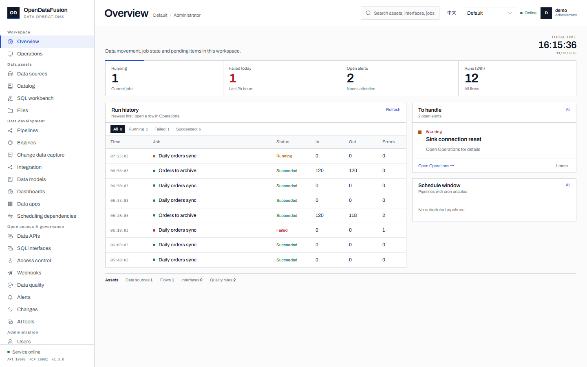
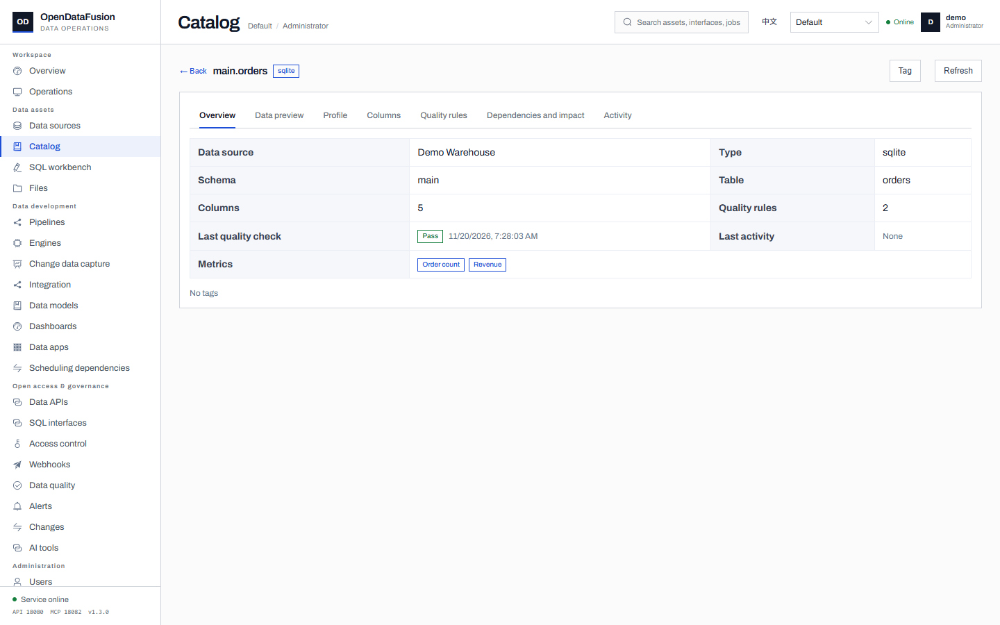
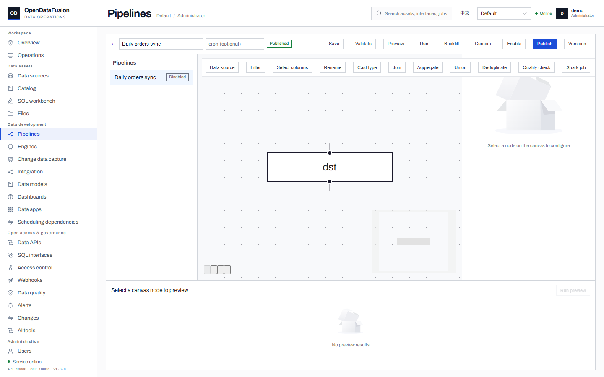
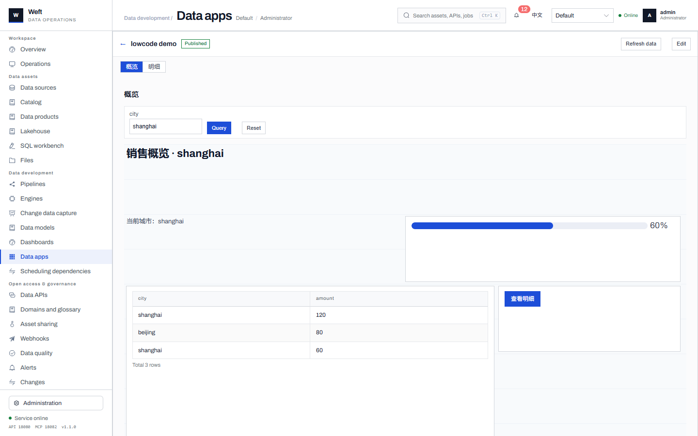
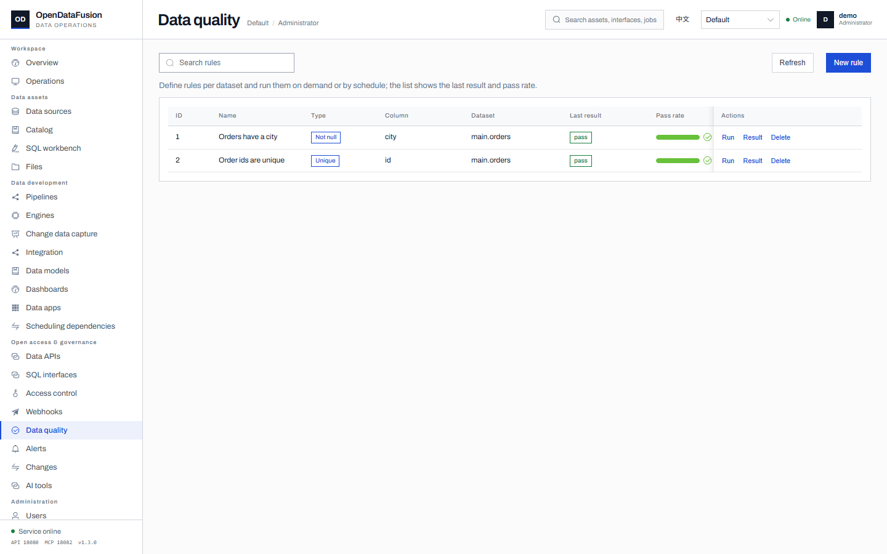
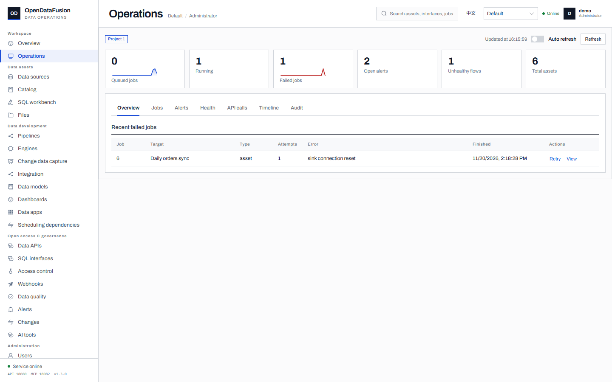

# Weft Data Platform

**面向完整数据交付闭环的 API 优先开源低代码数据平台。**

连接数据源，移动与转换数据，建模数据集和指标，发布受治理 API，构建看板与内部应用，
并在同一个项目空间中统一运维。外部操作方也可以通过 MCP 使用相同能力。

[English](README.md) · [简体中文](README.zh-CN.md)

[](https://github.com/CildCo/weft/actions/workflows/ci.yml)
[](LICENSE)
[](https://github.com/CildCo/weft/releases)
[](https://github.com/CildCo/weft/pkgs/container/weft)



*快速浏览：概览、目录剖析、管道工作室、指标与看板。*


<details>
<summary>目录</summary>

- [1.1.0 更新](#110-更新)
- [平台介绍](#平台介绍)
- [控制台一览](#控制台一览)
- [为什么选择 Weft](#为什么选择-weft)
- [功能总览](#功能总览)
- [已完成的集成验证](#已完成的集成验证)
- [架构](#架构)
- [快速开始](#快速开始)
- [文档](#文档)
- [开发](#开发)
- [社区](#社区)
- [安全](#安全)
- [许可证](#许可证)

</details>

## 1.1.0 更新

1.1.0 是公开项目的新基线，将当前平台的完整能力集中到一个版本：

- **数据产品**成为一等资产，支持负责人、SLA、条款和成员资产，并可打包导出。
- **数据标准**管理，以及数据目录中的字段级标准映射、权限控制和审计。
- **外部元数据导入**：支持 dbt 清单和 BI 元数据，外部数据集以只读方式进入物理目录。
- **低代码应用组件**：文件上传、审批队列、列表组件及内置应用模板。
- **资产信任与生命周期**：认证、生命周期说明、运行优先级、时长 SLA 和健康视图。
- **成本归因与分布漂移**：运维中心展示成本，质量模块支持漂移检测。
- **嵌入 SDK、页面角色、条件样式和术语批量导入**，完善分享与治理。
- **DuckDB 质量规则和管道节点编辑修复**，已在真实集成环境中验证。
- **产品更名为 Weft Data Platform（简称 Weft）**，既有部署继续使用稳定的
  `odf` 技术命名空间。

公开版本从 1.1.0 重新计数，旧版本标签和发布已在本次重置中退役，git 历史仍然保留。

## 平台介绍

Weft 是一个可自托管的数据平台，将通常分散在数据接入、转换框架、数据目录、
BI 工具和内部应用搭建器中的工作集中到一个按项目隔离的工作空间。平台提供可视化管道
工作室、受治理的 API 工作室、数据集与指标建模、看板、数据应用、基于 Apache Iceberg
的湖仓层（由 Trino、Spark、Flink 执行）、Debezium 变更数据捕获，以及面向外部操作方的
MCP 服务。

**适用场景：** 低代码 ETL/ELT 与数据集成；带血缘和质量规则的数据目录；使用 AK/SK
的受治理数据 API；自助看板与内部应用；Kubernetes 上的湖仓控制平面。

<details>
<summary>搜索关键词</summary>

开源数据平台、低代码 ETL、数据集成、数据管道、湖仓、Apache Iceberg、Nessie、Trino、
Apache Spark、Apache Flink、Kafka、Debezium、CDC、数据目录、数据血缘、数据质量、
数据治理、API 网关、内部工具、BI 看板、数据产品、语义层、MCP、数据智能体、FastAPI、
Vue 3、Kubernetes。

</details>

## 控制台一览

以下截图为英文控制台；所有页面均可通过页头切换到中文。

| | |
| --- | --- |
|  **数据目录与剖析。** 表与字段搜索、标签、脱敏样例、剖析、质量规则、影响分析和活动记录集中在一个详情页。 |  **管道工作室。** 可视化 DAG，包含数据源、过滤、关联、聚合、质量、引擎和目标节点；支持校验、预览、版本发布、调度和受限回填。 |
|  **SQL 工作台。** 只读查询、受治理数据源、字段补全、结果图表、执行计划和 CSV 导出。 |  **语义层。** 指标目录展示来源数据集、定义、负责人以及使用该指标的看板和应用。 |
|  **看板。** 卡片、图表、表格、地图和文本组成的 12 列网格，支持筛选、下钻、定时报表、版本发布和限时分享链接。 |  **数据应用。** 多页内部应用，支持参数、指标卡、表格、文件上传、审批队列和基于已发布数据集的受审计表单。 |
|  **数据质量。** 新鲜度、空值、唯一性、范围、枚举、漂移和结构规则，展示通过率、SLA 告警和每次运行结果。 |  **运维中心。** 队列与失败、死信重放、告警处理、依赖跳过、成本归因、API 调用和审计集中展示。 |

## 为什么选择 Weft

- **一条交付闭环。** 数据源 → 管道 → 数据集/指标 → API、看板、应用或数据产品，
  血缘、质量、审批和审计都在同一产品模型中。
- **为运维而设计。** PostgreSQL 持久任务队列、可重试 worker、单主调度器、
  游标安全的回填、健康事件、指标和备份脚本。
- **治理状态可见。** 字段脱敏、行级策略、受治理 SQL 限制、数据标准、质量规则和
  审批发布都是显式状态，而不是隐藏的错误路径。
- **运行在自有数据平面。** 执行适配覆盖关系数据库、DuckDB、对象存储、Trino/Iceberg、
  Spark 和 Flink，不改变资产模型和权限模型。
- **无需聊天界面即可被智能体操作。** MCP 服务向外部智能体提供读取工具和审批保护的
  写入工具；所有管理动作也可通过 HTTP 完成。

## 功能总览

| 领域 | 能力 |
| --- | --- |
| **数据源** | 统一连接器注册表，覆盖关系数据库、openGauss、KingbaseES、GaussDB、达梦 DM、ClickHouse、Trino、DuckDB、Hive/Spark Thrift、S3/MinIO、文件、HTTP、Elasticsearch、MongoDB、Kafka 和 Airbyte 协议数据源。支持类型化表单、能力范围、保存前测试、加密 DSN、元数据同步和结构漂移告警。 |
| **管道工作室** | 可视化 DAG，包含数据源、过滤、选列、重命名、类型转换、关联、聚合、并集、去重、质量、Spark、Flink SQL 和目标节点；支持结构校验、节点错误策略、预览、版本发布、Cron、游标查看/重置、受限回填、模板和失败处理。 |
| **API 工作室** | 可视化单表查询或受保护 SQL；类型化参数；预览/测试；审批发布与回滚；自动文档；通过 `/openapi/{key}` 使用 AK/SK 调用；`/openapi/graphql` 提供 GraphQL 网关和结构自省。 |
| **模型工作室** | 数据集、指标和转换模型资产；可视化与 SQL 数据集；表达式指标；时间粒度和对比；带 refs、视图/表/增量物化、测试、数仓分层和字段级血缘的 SQL 模型；审批发布。 |
| **看板工作室** | 12 列看板，支持卡片、图表、表格、地图和文本；筛选与参数绑定；下钻；GeoJSON 地图；定时 CSV 报表；拖拽缩放编辑器；版本发布；只读运行、分享链接和嵌入代码。 |
| **应用工作室** | 多页应用，支持参数、绑定、动作、页面角色、组件样式、条件高亮、容器、标签页、弹窗、上传、审批队列和列表；内置应用模板；公开分享模式会移除写入组件。 |
| **数据产品** | 产品资产包含负责人、SLA、条款和成员资产；支持打包与 bundle 导出；按项目成本归因；使用情况和血缘统一查看。 |
| **湖仓** | 基于 Apache Iceberg 的 Trino 数据源，支持表健康、快照、精确快照时间旅行、小文件优化、快照过期和定时维护。 |
| **计算引擎** | 通过 Spark Operator 提交 Spark 应用，通过 SQL Gateway 执行 Flink SQL；支持提交、查看、取消和 savepoint，并默认应用湖仓配置。 |
| **变更数据捕获** | 在平台内创建、暂停、恢复和监控 PostgreSQL、MySQL、Oracle 的 Debezium 连接器；变更进入 Kafka 供 Flink 或 Spark 消费；生成的 CDC 管道支持结构演进和删除。 |
| **目录与血缘** | 表与字段搜索、标签、业务域和术语、字段级血缘、下游影响分析、OpenLineage 事件、外部元数据导入和 JSON 目录导出。 |
| **治理** | 字段分类与脱敏、行级策略、数据标准与字段映射、带新鲜度/质量检查的数据契约、质量 SLA 告警、审批变更和审计支撑的策略更新。 |
| **运维** | 运维中心、队列概览、重试、死信重放、依赖调度、告警分派与备注、成本归因、保留与归档、Prometheus 指标和备份恢复。 |
| **管理** | 平台控制台管理用户与角色、项目与配额、登录策略、OIDC/LDAP、品牌与公告、功能开关、引擎、CDC、Airbyte 和血缘设置、备份与平台审计。 |
| **开放 API 与 MCP** | 管理 API、签名公开网关、Streamable HTTP MCP 服务、stdio MCP 入口和审批令牌保护的写入工具。 |

## 已完成的集成验证

当前版本已通过控制台在真实数据平面上完成端到端验证，包括：

- Trino/Iceberg 数据源查询、目录详情、湖仓健康、快照、时间旅行和物化模型表。
- 通过 SQL Gateway 执行 Flink SQL，以及 Spark 执行配置。
- DuckDB 和 openGauss 连接器的测试、元数据同步和受治理查询。
- 管理员命令白名单下的 Airbyte 协议连接器。
- Kafka 源到目标管道，并在目标 Topic 中确认消息。
- DuckDB 数据集 → 指标 → 看板地图渲染、契约生成与定时检查历史、质量 SLA 告警。
- 角色隔离、数据保留、数据源限流、死信重放、GraphQL、导出、嵌入和移动端导航。

## 架构

```text
                 ┌──────────────────────────────┐
                 │  反向代理 / TLS               │
                 └──────────────┬───────────────┘
                                │
        ┌───────────────────────┼───────────────────────┐
        ▼                       ▼                       ▼
┌───────────────┐      ┌─────────────────┐     ┌─────────────────┐
│ odf-api       │      │ odf-mcp         │     │ 静态控制台       │
│ FastAPI       │      │ Streamable HTTP │     │ Vue 3 / /ui/    │
└───────┬───────┘      └────────┬────────┘     └─────────────────┘
        │                       │
        └───────────┬───────────┘
                    ▼
          ┌──────────────────┐
          │ PostgreSQL       │
          │ 控制面 + 任务队列 │
          └───────┬──────────┘
                  │
        ┌─────────┴─────────┐
        ▼                   ▼
┌───────────────┐    ┌─────────────────┐
│ odf-scheduler │    │ odf-worker × N  │
│ 主节点锁       │    │ SKIP LOCKED     │
└───────────────┘    └─────────────────┘
```

API 无状态，调度与执行持久化并可独立扩展。参见
[架构](docs/ARCHITECTURE.md)、[交付](docs/DELIVERY.md)、[高可用](docs/HA.md) 和
[安全](docs/SECURITY.md)。

## 快速开始

### Docker Compose

```bash
git clone https://github.com/CildCo/weft.git
cd weft/deploy/docker
cp .env.example .env
./../../scripts/generate-env.sh .env
docker compose up -d --build
docker compose exec api weft create-admin \
  --username admin --password 'ChangeMe123!'
```

打开 <http://localhost:18080/ui/> 并登录。API 监听 `18080`，MCP 监听 `18082`。

### 本地开发

```bash
cd impl
python -m venv .venv
.venv/bin/pip install -e ".[dev]"
cp .env.example .env
# 设置 ODF_DATABASE_URL、ODF_JWT_SECRET 和 ODF_FERNET_KEY
.venv/bin/alembic upgrade head
.venv/bin/weft create-admin \
  --username admin --password 'ChangeMe123!'

# 分别启动
.venv/bin/uvicorn odf.main:app --host 127.0.0.1 --port 18080
.venv/bin/python -m odf.scheduler
.venv/bin/python -m odf.worker
```

前端构建产物位于 `impl/odf/static`，通过 `/ui/` 提供。前端开发参见
[frontend/README.md](frontend/README.md)。

## 文档

| 文档 | 内容 |
| --- | --- |
| [架构](docs/ARCHITECTURE.md) | 进程、执行语义、扩展与故障模型 |
| [交付](docs/DELIVERY.md) | Docker、Compose、Helm 与 systemd |
| [治理](docs/GOVERNANCE.md) | 目录、血缘、脱敏、行级策略、标准、契约、质量与审计 |
| [高可用](docs/HA.md) | 主节点选举、worker 扩展、备份与恢复 |
| [安全](docs/SECURITY.md) | 信任边界、密钥、SSRF 控制与漏洞报告 |
| [性能](docs/PERFORMANCE.md) | 指标、连接池、压测与基准结果 |
| [基准](docs/BENCHMARKS.md) | 30GB 多源结果与缓存实验 |
| [测试](docs/TESTING.md) | 单元、集成、浏览器与全矩阵测试 |
| [环境](docs/ENVIRONMENTS.md) | 环境标签、资产 bundle 与晋升 |
| [连接器 SDK](docs/CONNECTOR_SDK.md) | 注册外部连接器包 |
| [Airbyte](docs/AIRBYTE.md) | 将 Airbyte 协议源作为管道输入 |
| [转换模型](docs/MODELS.md) | SQL 模型、refs、物化、测试与分层 |
| [湖仓](docs/LAKEHOUSE.md) | 快照、时间旅行、健康与维护计划 |
| [血缘与目录导出](docs/LINEAGE.md) | OpenLineage 事件与外部目录同步 |
| [查询工作台与性能](docs/QUERY.md) | 查询历史、执行计划与 P50/P95 分析 |
| [变更数据捕获](docs/STREAMING.md) | Debezium 数据源与生成的 CDC 管道 |
| [模板](docs/TEMPLATES.md) | 模型与管道起点 |
| [运维](docs/OPERATIONS.md) | 保留、死信、数据源限流、系统自检与高可用验证 |
| [编辑体验](docs/INTERACTION.md) | 撤销/重做、画布复制与布局、画廊、回填预览与运行矩阵 |
| [使用指南](docs/USER_GUIDE.zh-CN.md) | 每个控制台页面与操作（另有[英文版](docs/USER_GUIDE.md)） |

## 开发

- 后端：Python 3.11、FastAPI、SQLAlchemy 2、Alembic、PostgreSQL。
- 前端：Vue 3、Vite、Element Plus、Vue Flow、CodeMirror、ECharts。
- `odf` Python 包、`ODF_*` 环境变量和 systemd 单元名称作为既有部署的稳定技术命名空间保留；
  产品和控制台统一使用 Weft 品牌。
- 默认分支：`main`。拉取请求会运行单元、集成、浏览器和 Helm 检查。
- 提交拉取请求前请阅读 [CONTRIBUTING.md](CONTRIBUTING.md)。
- 控制台测试：`cd frontend && npm ci && npx playwright install chromium && npm run test:e2e`。

## 社区

- [GitHub Issues](https://github.com/CildCo/weft/issues)：缺陷和明确的功能请求。
- [GitHub Discussions](https://github.com/CildCo/weft/discussions)：设计讨论、部署帮助和展示。
- [路线图](ROADMAP.md) 和 [变更日志](CHANGELOG.md)。
- [行为准则](CODE_OF_CONDUCT.md) 和 [支持](SUPPORT.md)。

## 安全

请按 [SECURITY.md](SECURITY.md) 私下报告疑似漏洞，不要公开提交 Issue。平台会加密保存
密钥、校验出站 Webhook 主机、以只读方式运行 SQL 工作台，并对发布操作执行审批和审计。

## 许可证

Apache License 2.0，参见 [LICENSE](LICENSE)。项目名称和标识受
[TRADEMARK.md](TRADEMARK.md) 保护；欢迎 fork，但请勿暗示官方背书。
